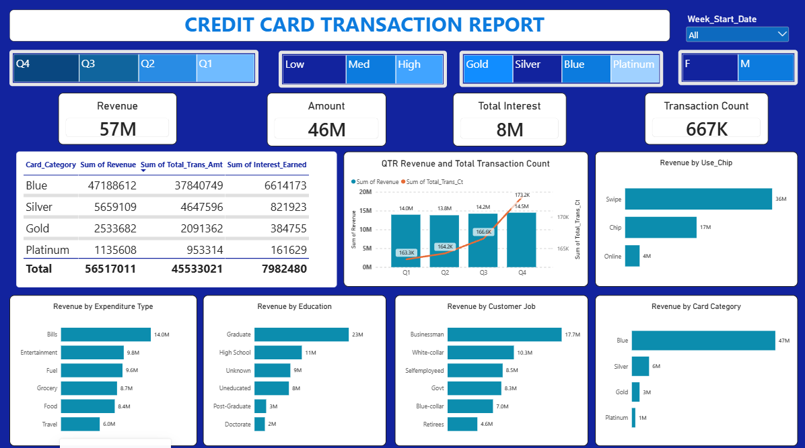
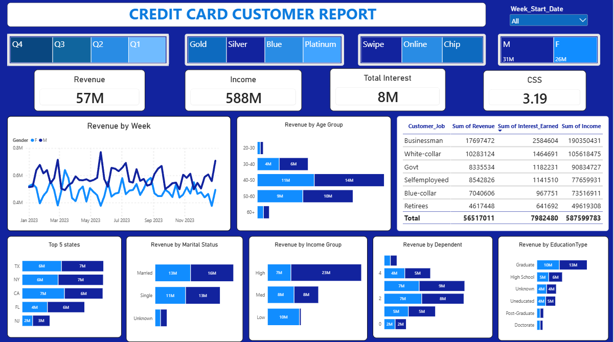
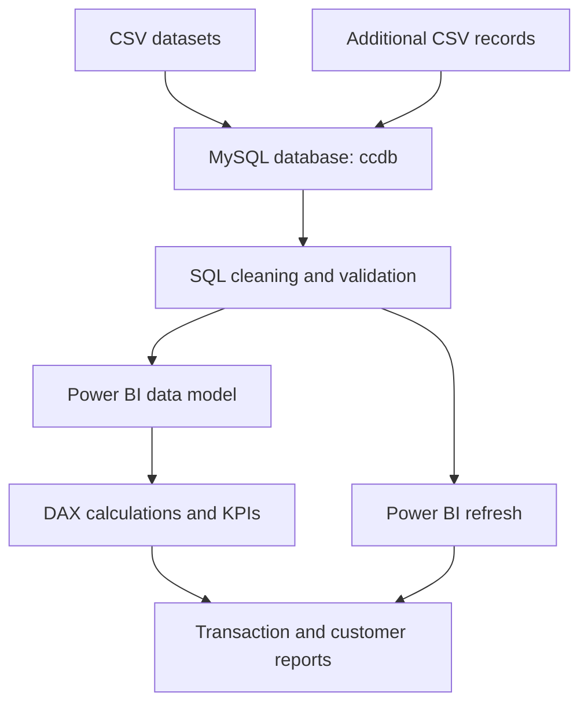

# Credit Card Financial Analytics Dashboard

An end-to-end financial analytics project built using **Power BI, MySQL, DAX and Power Query** to explore credit card transactions, customer demographics and weekly financial performance. The report supports refresh-based updates from a MySQL database without rebuilding the visuals.

## Project Objectives

- Monitor transaction amounts, transaction counts, interest earned and project-defined revenue.
- Analyze spending patterns across card categories, expenditure types and payment methods.
- Understand customer segments by age, gender, income, occupation, education and location.
- Track weekly and quarterly performance and support data-driven business decisions.
- Demonstrate SQL-based data preparation, validation and incremental data loading.

## Dashboard Preview

### Credit Card Transaction Report



Includes financial KPI cards, quarterly revenue and transaction trends, expenditure analysis, card category performance and interactive filters.

### Credit Card Customer Report



Includes weekly revenue by gender, customer satisfaction, customer income, age groups, occupation, education, marital status, dependents and top states.

## Tools and Technologies

| Tool | Purpose |
| --- | --- |
| MySQL | Database storage, CSV imports, data cleaning and validation |
| MySQL Workbench | SQL development and troubleshooting |
| Power BI Desktop | Interactive report development and visualization |
| Power Query | Data preparation and transformation |
| DAX | Calculated columns, financial KPIs and weekly growth analysis |
| MySQL Connector/NET | Database connectivity |

## Dataset and Data Model

| Source file | Destination | Purpose |
| --- | --- | --- |
| `credit_card.csv` | `cc_detail` | Initial credit card transaction data |
| `customer.csv` | `cust_detail` | Customer demographic data |
| `cc_add.csv` | `cc_detail` | Additional credit card records |
| `cust_add.csv` | `cust_detail` | Additional customer records |

Both tables share `Client_Num`, which enables customer-level financial analysis. Customer identifiers were checked for duplicates before report refresh. The actual relationship cardinality should be inspected in Power BI Model view.

## Project Workflow



1. Created the `ccdb` database and separate transaction and customer tables.
2. Imported CSV files using `LOAD DATA LOCAL INFILE` with explicit column mapping where required.
3. Corrected date-format inconsistencies using `STR_TO_DATE()` and preserved original data in backup tables.
4. Validated row counts, import warnings, date values and duplicate customer identifiers using SQL.
5. Connected MySQL to Power BI and linked customer and transaction information through `Client_Num`.
6. Created calculated columns, measures, KPI cards, interactive slicers and two report pages.
7. Appended additional records to MySQL and refreshed the existing Power BI report.

## Key Performance Indicators

The following figures are from the updated transaction report after additional data loading. Values are shown in the dataset's monetary units; currency is not independently verified.

| KPI | Report value |
| --- | ---: |
| Project-defined revenue | 56,517,011 |
| Total transaction amount | 45,533,021 |
| Total interest earned | 7,982,480 |
| Transaction count | Approximately 667,000 |
| Customer satisfaction score | 3.19 |
| Total customer income | Approximately 588 million |

**Metric note:** Revenue is a project-defined reporting metric, not verified bank accounting revenue. Transaction amounts represent spending rather than bank earnings. The exact DAX formulas, income aggregation and satisfaction scale should be checked in the PBIX file before interpreting these metrics.

## Key Business Insights

- Blue cards account for approximately 83.5% of project-defined revenue, indicating a strong concentration in one card category.
- Swipe transactions contribute the largest reported revenue by payment method (approximately 36 million), followed by chip and online transactions.
- Bills are the leading expenditure category by reported revenue (approximately 14 million).
- Q4 shows the highest quarterly transaction count (approximately 173,200) and reported revenue (approximately 14.5 million).
- Business owners form the leading occupation segment by reported revenue (approximately 17.7 million).

## Business Recommendations

- Investigate card-category concentration and compare profitability and utilization across card tiers before designing targeted offers.
- Evaluate barriers to online card usage and test digital-payment incentives where appropriate.
- Examine customer-level spending and engagement metrics to identify suitable customer segments for personalized campaigns.
- Use transaction and revenue trends to investigate seasonal demand and plan future campaigns.

These are proposed actions based on descriptive analysis, not measured outcomes or proven causal relationships.

## Data Quality and Technical Challenges

| Challenge | Resolution |
| --- | --- |
| Local file import restriction (Error 3948) | Enabled local loading on the trusted MySQL server and Workbench client. |
| Invalid dates (`0000-00-00`) | Converted `DD-MM-YYYY` dates using `STR_TO_DATE()` and reimported into a corrected table. |
| CSV and SQL column name mismatch | Inspected the schema with `DESCRIBE` and corrected the destination column mapping. |
| Power BI connector detection failure | Diagnosed duplicate MySQL provider registrations with PowerShell and removed the duplicate after creating a configuration backup. |
| Incorrect records loaded into the customer table | Identified inconsistent values, backed up the table and removed 370 incorrect records using a transaction-controlled deletion. |
| Duplicate customer identifiers | Validated with `GROUP BY` and `HAVING COUNT(*) > 1`; the query returned no rows. |

The corrected initial credit card import contained **10,108 records, 52 distinct weekly dates and zero import warnings**. Both additional CSV imports successfully added **185 records each with zero warnings**. The expected final counts are 10,293 rows in each main table and 53 distinct weekly dates; the final combined count result was not independently supplied.

## Dynamic Data Refresh

The project demonstrates incremental source-data loading: additional CSV records are appended to MySQL, validated, and then loaded into the existing Power BI report using **Home > Refresh**. Existing charts and calculations update without recreating the report. This is refresh-based reporting, not a continuous real-time streaming system or a configured Power BI incremental refresh policy.

## Repository Structure

```text
Credit-Card-Financial-Analytics/
├── README.md
├── SQL_Queries.sql
├── Credit_Card_Report.pbix
├── Dashboard_Report.pdf
└── Screenshots/
    ├── Transaction_Report.png
    └── Customer_Report.png
```

- [SQL implementation](SQL_Queries_Credit_Card.sql)
- [Power BI report](Credit_Card_Report.pbix)
- [Dashboard PDF](Credit%20Card%20Financial%20Dashboard.pdf)

## How to Run

1. Install MySQL, MySQL Workbench, Power BI Desktop and the compatible MySQL Connector/NET.
2. Review `SQL_Queries.sql` and create the required database and tables. The exact original customer table DDL must be supplied separately using `SHOW CREATE TABLE cust_detail`.
3. Obtain the permitted sample datasets, update local file paths in the SQL script and execute the relevant sections individually. Do not rerun historical repair or import steps on an already populated database.
4. Open the PBIX file in Power BI Desktop and configure the MySQL connection for your own server and credentials (original project: `localhost:3306`, database `ccdb`).
5. Validate the data model and refresh the report. Disable local file loading when it is no longer needed.

The PDF provides a static preview for viewers without Power BI. The PBIX contains the interactive report and may contain imported data. Share only datasets and report files that you have permission to redistribute; do not include database passwords, private customer data or other credentials.

## Skills Demonstrated

SQL · MySQL · Power BI · DAX · Power Query · Data Cleaning · Data Validation · Data Modeling · KPI Analysis · Data Visualization · Financial Analytics · Business Intelligence · Troubleshooting
